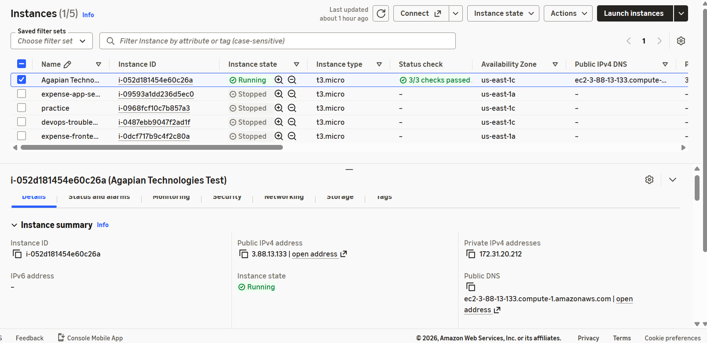
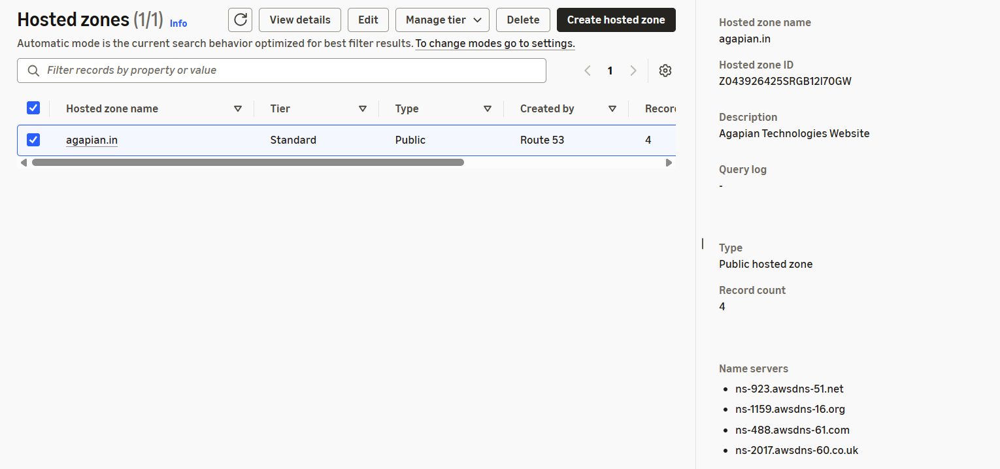
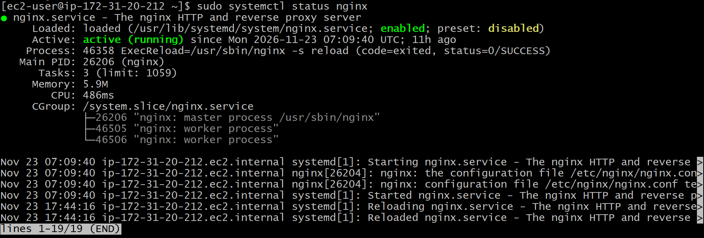
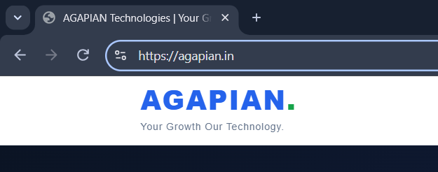
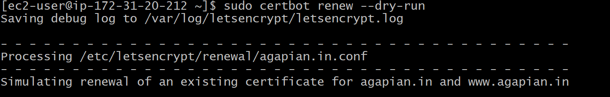

# AGAPIAN Technologies – AWS Website Deployment with HTTPS

## Project Overview

Deployed the AGAPIAN Technologies business website on an AWS EC2 instance using Nginx. Configured a custom domain through Amazon Route 53 and implemented HTTPS using a free Let's Encrypt SSL/TLS certificate with Certbot.

**Live Website:** https://agapian.in

## Technologies Used

- AWS EC2 – Virtual server hosting
- Amazon Linux 2023 – Operating system
- Nginx – Web server
- Amazon Route 53 – DNS management
- GoDaddy – Domain registrar
- Let's Encrypt – SSL/TLS certificate
- Certbot – Certificate installation and renewal
- Linux – Server administration

## Architecture

Visitor → Domain → Route 53 DNS → AWS EC2 → Nginx → Website

HTTPS traffic is handled through port 443, while HTTP traffic on port 80 is redirected to HTTPS.

## Implementation Steps

1. Created and configured an AWS EC2 t3.micro instance.
2. Connected to EC2 using SSH.
3. Installed and configured Nginx on Amazon Linux 2023.
4. Deployed website files to `/usr/share/nginx/html/`.
5. Configured security group rules for SSH (22), HTTP (80), and HTTPS (443).
6. Created a Route 53 hosted zone.
7. Updated GoDaddy nameservers to Route 53 nameservers.
8. Configured A records for the root domain and www subdomain.
9. Installed Certbot and its Nginx plugin.
10. Generated a free Let's Encrypt certificate for both domains.
11. Configured Nginx to support HTTPS.
12. Enabled automatic HTTP-to-HTTPS redirection.
13. Tested HTTPS connectivity and certificate renewal.

## Verification Results

| Test | Result |
|---|---|
| https://agapian.in | HTTP 200 OK |
| https://www.agapian.in | HTTP 200 OK |
| HTTP to HTTPS redirect | HTTP 301 |
| Certbot renewal dry run | Successful |

## Key Learnings

- AWS EC2 provisioning and Linux administration
- Nginx installation and configuration
- DNS management using Route 53
- Domain delegation and DNS records
- SSL/TLS certificate configuration
- HTTPS redirection
- Certificate renewal and troubleshooting

## Project Status

Successfully deployed and accessible through HTTPS.

**Note:** This is a personal deployment project for AGAPIAN Technologies.


## Architecture Diagram

## Architecture Diagram

```text
Website Visitor
      |
      v
agapian.in
      |
      v
Amazon Route 53
      |
      v
AWS EC2 (Amazon Linux 2023)
      |
      v
Nginx Web Server
      |
      v
AGAPIAN Website

### HTTPS Configuration

- HTTPS traffic is handled through port 443.
- HTTP traffic through port 80 is redirected to HTTPS.
- Let's Encrypt provides the SSL/TLS certificate.
- Certbot manages certificate installation and renewal.

## Important Commands Used

| Purpose | Command |
|---|---|
| Check Nginx status | `sudo systemctl status nginx` |
| Test Nginx configuration | `sudo nginx -t` |
| Reload Nginx | `sudo systemctl reload nginx` |
| Check HTTP response | `curl -I http://agapian.in` |
| Check HTTPS response | `curl -I https://agapian.in` |
| Check certificate | `sudo certbot certificates` |
| Test certificate renewal | `sudo certbot renew --dry-run` |

## Troubleshooting

### Issue: Certbot could not find a matching Nginx server block

**Cause:** The Nginx configuration initially used `server_name _;` instead of the actual domain names.

**Solution:** Updated the Nginx server configuration to include:

`server_name agapian.in www.agapian.in;`

**Verification:** Successfully installed the existing certificate using Certbot and reloaded Nginx.

## Deployment Screenshots

### EC2 Instance


### Route 53 DNS


### Nginx Status


### HTTPS Website


### SSL Renewal


